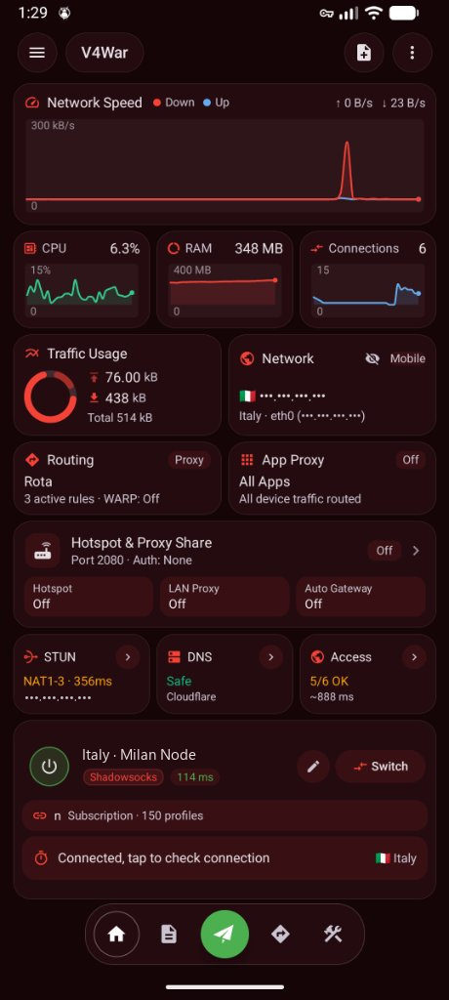
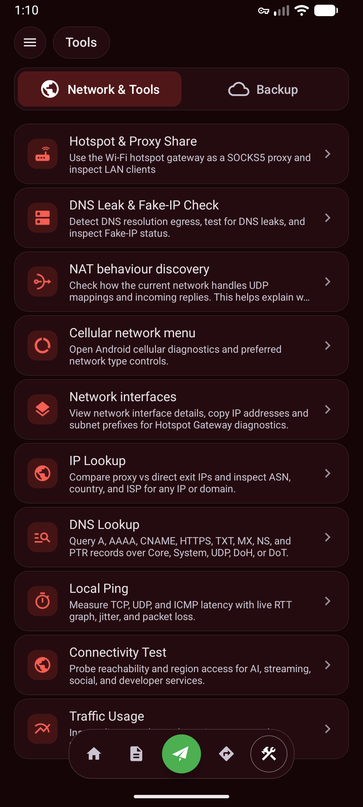
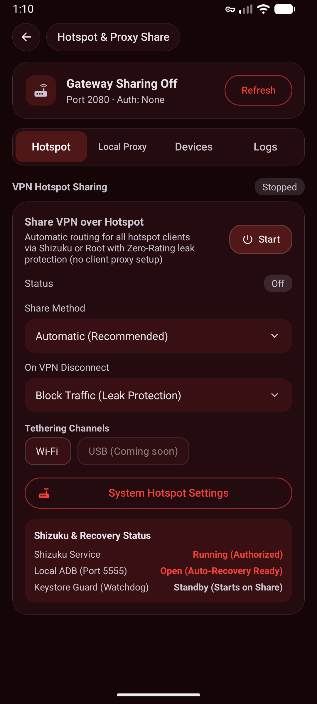
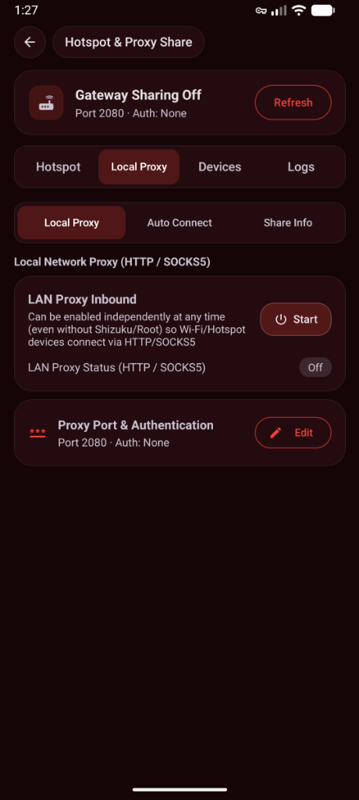
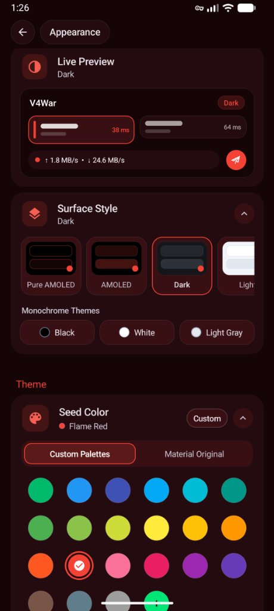

<div align="center">


# V4War for Android

**Next-Generation Android VPN & Proxy Client · Empowered by Sing-box & Xray**

[🇬🇧 English](README.md) · [🇹🇷 Türkçe](README.tr.md)

<p>
  <a href="https://github.com/theyusa/V4War/actions/workflows/ci.yml"></a>
  <a href="https://github.com/theyusa/V4War/releases"></a>
  <a href="https://github.com/theyusa/V4War/releases"></a>
  <a href="LICENSE"></a>
</p>

<p>
  
  
  <a href="https://github.com/throneproj/ThroneForAndroid"></a>
  <a href="#-daily-upstream-sync"></a>
</p>

<p>
  <a href="https://v4war.theyusa.tr/">
    
  </a>
  <a href="https://github.com/theyusa/V4War/releases">
    
  </a>
</p>

</div>

> 🔀 **V4War** is an actively maintained, feature-rich fork of [throneproj/ThroneForAndroid](https://github.com/throneproj/ThroneForAndroid).
> On top of the unified Sing-box & Xray VPN core, V4War introduces a **compact Bento Home dashboard with IP privacy toggle**, a **complete Hotspot & Proxy Share suite (Shizuku TUN, Root `iptables`, & Rootless LAN Proxy)**, a **10-in-1 Network Toolbox**, a **Material 3 Expressive UI with Theme Studio (Pure AMOLED)**, **per-profile Traffic Usage & after-VPN `.srs` rule-set downloads**, **unified App Updates**, and **hardened TLS fragmentation** out of the box.

<p align="center">
  <table>
    <tr>
      <th width="33%" align="center">Home Dashboard</th>
      <th width="33%" align="center">10-in-1 Tools</th>
      <th width="33%" align="center">Hotspot &amp; Proxy Share</th>
    </tr>
    <tr>
      <td width="33%" align="center"></td>
      <td width="33%" align="center"></td>
      <td width="33%" align="center"></td>
    </tr>
  </table>
</p>

---

## 📑 Contents

- [Hotspot & Proxy Share Suite](#-hotspot--proxy-share-suite)
- [10-in-1 Network Toolbox & Diagnostics](#-10-in-1-network-toolbox--diagnostics)
- [Material 3 Expressive UI & Theme Studio](#-material-3-expressive-ui--theme-studio)
- [Core, Security & Smart Updates](#-core-security--smart-updates)
- [Supported Protocols](#-supported-protocols)
- [Installation & Building](#-installation--building)
- [Daily Upstream Sync](#-daily-upstream-sync)
- [Credits, FAQ & License](#-credits)

---

## 🚀 Hotspot & Proxy Share Suite

Share your active VPN connection with phones, laptops, consoles, and other devices over **Wi-Fi Hotspot**, **USB RNDIS Tethering**, or **Bluetooth PAN Tethering** — with or without root.

### Sharing Backends

| Mode | Privilege | How It Works | Key Highlights |
|---|---|---|---|
| **Auto** | Adaptive | Automatically selects `Root → Shizuku → LAN Proxy` | Seamless fallback if Root or Shizuku is unavailable |
| **Shizuku** | Rootless (UID 2000) | AOSP `TestNetworkManager` + `TetheringManager` + `hev-socks5-tunnel` | True transparent TUN tethering without root, dual-stack TUN, upstream drift watchdog, ADB `127.0.0.1:5555` watchdog revival, binder-death recovery |
| **Root** | `libsu` (Superuser) | Custom `iptables` chains + `RootTetherHelper` auto-tether | Idempotent rule deduplication, IPv6 leak prevention, configurable fail-closed action (`Block Traffic` or `Stop Hotspot`) on VPN drop |
| **LAN Proxy** | Unprivileged | Local `SOCKS5` / `HTTP` / `Mixed` inbound socket binding | Zero-config pairing between V4War devices and [theyusa/Throne](https://github.com/theyusa/Throne) desktop, optional credentials, UDP-over-TCP (UoT), one-tap `socks5://` share link |

### Multi-Channel & System Integration

- 📡 **Wi-Fi Hotspot, USB RNDIS & Bluetooth PAN:** Share over mobile hotspot, USB tethering (with RNDIS reset/recovery hardening), or Bluetooth PAN.
- 🎛️ **Quick Settings Tile:** Toggle sharing directly from Android's Quick Settings panel (`HotspotShareTileService`) with live active channel and mode status.
- 📊 **Live Client & Traffic Monitor:** `TetherWatchService` tracks real-time shared throughput and connected clients via Clash API (`/connections`) + kernel ARP fallback.
- 🧾 **Cross-Process Diagnostic Log Drawer:** Inspect backend, `hev-socks5-tunnel`, Shizuku UserService, and Root shell events directly inside a compact Material 3 log drawer.
- 💻 **Zero-Config Desktop Pairing:** Connect your Windows or Linux PC running [theyusa/Throne](https://github.com/theyusa/Throne) to your phone's hotspot and enable `Settings → Basic Settings → Hotspot Gateway` — no IP or port typing needed.

<details>
<summary>📸 Preview: LAN Sharing & Hotspot Gateway Screen</summary>

<table>
  <tr>
    <th width="50%" align="center">Hotspot Gateway</th>
    <th width="50%" align="center">Local Proxy (HTTP / SOCKS5)</th>
  </tr>
  <tr>
    <td width="50%" align="center"></td>
    <td width="50%" align="center"></td>
  </tr>
</table>

</details>

---

## 🧰 10-in-1 Network Toolbox & Diagnostics

Accessible from **Tools → Network**, V4War includes ten built-in diagnostic engines with Material 3 Expressive visual charts:

| Tool | Capabilities |
|---|---|
| **Hotspot & Proxy Share** | Unified control center for Auto / Shizuku / Root / LAN Proxy sharing, USB/BT/Wi-Fi tethering, client list, and logs |
| **DNS Leak & Fake-IP Check** | Compares client public egress vs DNS resolver egress, verifies Fake-IP / Strict Route isolation, and inspects System Private DNS (DoT) |
| **STUN NAT Behaviour Discovery** | Pure Kotlin **RFC 5389 / 5780** NAT classifier (Open, Full-Cone, Restricted-Cone, Port-Restricted-Cone, Symmetric), RTT/jitter/loss metrics, custom server presets, and **physical network VPN bypass** |
| **IP Lookup & Exit Comparison** | Side-by-side **Proxy Exit vs Direct Physical Exit** check plus ASN, ISP, country, timezone, and IP range classification for any IP, domain, or URL |
| **DNS Lookup** | Query `A`, `AAAA`, `CNAME`, `HTTPS`, `TXT`, `MX`, `NS`, and `PTR` records over Core, System DNS, or Custom resolvers (`UDP`, `DoH`, `DoT`) with side-by-side comparison |
| **Local Ping** | Measure `TCP`, `UDP`, and `ICMP` latency with a live RTT timeline chart, min/avg/max, jitter, packet loss, and direct physical network toggle |
| **Connectivity Test** | One-tap reachability & region probe across **AI** (ChatGPT, Claude, Gemini, Grok, Perplexity, OpenRouter), **Streaming** (Netflix, YouTube, Disney+, Spotify, Twitch, TikTok), **Social** (Telegram, Discord, X, Reddit), and **Developer** (GitHub, Cloudflare, Google, Wikipedia, Docker, npm) |
| **Live Network Interfaces** | Real-time Active Network & System DNS overview, IPv4/IPv6 addresses, netmasks, MTU, MAC, flags, routes, and hotspot/tethered interface detection |
| **Traffic Usage Analytics** | Live proxy/direct speed, session vs app UID vs device totals, visual traffic bars, and per-profile / per-group usage history |
| **Cellular Network Menu** | Direct access to Android Radio Info diagnostics (modern & legacy), testing menu, and preferred network type controls (LTE/NR pinning) |

---

## 🎨 Material 3 Expressive UI & Theme Studio

- **Theme Studio (`Settings → Appearance`):** Live interactive miniature preview card with 5 surface modes — **Pure AMOLED**, **AMOLED**, **Dark**, **Light**, and **System**.
- **3-Tone Seed Harmonization:** Material 3 tonal palette system with curated seed colors, Android 12+ **Monet** dynamic theming, and harmonized dialogs, bars, switches, and squircle icon badges.
- **Expressive Navigation & Lists:** Floating pill headers, expressive tab indicators, protocol badges, compact profile rows, and compact group cards.

<details>
<summary>📸 Preview: Theme Studio (Appearance Settings)</summary>

<p align="center">
  
</p>

</details>

---

## 🔒 Core, Security & Smart Updates

- **Default TLS Record Fragmentation:** Enabled by default to strengthen fake SNI and CDN-fronting resilience out of the box.
- **Shizuku Silent App Updater:** Built-in fork update checker reading `v4war-update.json` (with SHA-256 & signing certificate pin verification, release notes from `CHANGELOG.md`, and optional GitHub API token), supporting **silent background installation via Shizuku** (`UpdateUserService`) as well as Obtainium tracking.
- **Groups, Routing & Backups:** Per-group routing profiles, Happ routing import, custom subscription SNI, route proxy hops, Auto Selector multi-group ranking, Cloudflare WARP (WireGuard & MASQUE), and cross-platform `.thrbackup` files with WebDAV sync and automatic credential sanitization (`HotspotBackupSanitizer`).
- **System & TV Support:** Home-screen widgets, Quick Settings tiles, notification bar actions, and native Android TV D-pad navigation with TV banner.

---

## 🔌 Supported Protocols

| | | | |
|---|---|---|---|
| 🧦 SOCKS5 | 🌐 HTTP(S) | 🛡️ Shadowsocks | 🐴 Trojan |
| 💬 VMess | ✉️ VLESS | ⚡ Xray VLESS | 🚀 TUIC |
| 🌀 Hysteria 1/2 | 🔗 AnyTLS | 🪨 Mieru | 🐚 Snell |
| 🦋 NaïveProxy | 🍹 Juicity | 🚇 TrustTunnel | 🎭 ShadowTLS |
| 🔐 WireGuard | 🔐 AmneziaWG | 🎭 MASQUE | 🔑 SSH |
| 🔒 OpenVPN | 🔓 OpenConnect | ➡️ Direct | ⛓️ Chain |
| 🧩 Custom Outbound | ✨ Auto Selector | 📡 DNSTT / VayDNS | 🎯 MasterDNS |

**Subscription Formats:** Standard share links, Sing-box JSON, v2rayN, Shadowsocks, Clash (outbound import), and deeplinks ([documentation](https://throneproj.github.io/advanced/deeplinks/)).

---

## 📦 Installation & Building

### Download Pre-built APKs

Grab the APK matching your device's CPU architecture from [**GitHub Releases**](https://github.com/theyusa/V4War/releases):

| Architecture | Target Devices |
|---|---|
| `arm64-v8a` | Most modern Android phones & tablets (2015+) |
| `armeabi-v7a` | Older 32-bit ARM devices |
| `x86_64` | Emulators & x86_64 Android systems |

### Build & Test from Source

Requires **JDK 17 or 21** and **Android SDK 35** (`buildToolsVersion = "35.0.1"`, `minSdk = 24`):

```bash
# Run JVM unit tests
./gradlew :app:testOssDebugUnitTest

# Build debug APK (requires ThroneCore AAR in app/libs/)
./gradlew :app:assembleOssDebug
```

> CI automatically fetches `ThroneCore`, `routeprofiles`, and `sing-box-dashboard` via `.github/actions/`. See [CONTRIBUTING.md](CONTRIBUTING.md) for full setup details.

---

## 🔄 Daily Upstream Sync

This repository stays aligned with upstream [throneproj/ThroneForAndroid](https://github.com/throneproj/ThroneForAndroid) via [`.github/workflows/sync-upstream.yml`](.github/workflows/sync-upstream.yml):

- 🕒 Runs daily at **03:00 UTC** (and supports manual `workflow_dispatch`).
- 🔍 Rebases fork commits cleanly onto `upstream/main` (`--no-tags --empty=drop`) and verifies `:app:testOssDebugUnitTest` before pushing to `main`.
- 🏷️ Custom Git merge drivers (`.gitattributes`) protect V4War identity, docs, CI workflows, and version metadata.

---

## 🙏 Credits

Built upon the work of the open-source community:

- **Upstream:** [throneproj/ThroneForAndroid](https://github.com/throneproj/ThroneForAndroid)
- **Cores:** [throneproj/sing-box](https://github.com/throneproj/sing-box) & [throneproj/Xray-core](https://github.com/throneproj/Xray-core)
- **Rootless TUN Engine:** [heiher/hev-socks5-tunnel](https://github.com/heiher/hev-socks5-tunnel)
- **Privilege & Shell Frameworks:** [RikkaApps/Shizuku](https://github.com/RikkaApps/Shizuku) & [topjohnwu/libsu](https://github.com/topjohnwu/libsu)
- **GUI Roots:** [MatsuriDayo/NekoBoxForAndroid](https://github.com/MatsuriDayo/NekoBoxForAndroid), [SagerNet/SagerNet](https://github.com/SagerNet/SagerNet), & [shadowsocks/shadowsocks-android](https://github.com/shadowsocks/shadowsocks-android)
- **Network Tools Inspiration:** [eleutherifer/NekoBoxPlus](https://github.com/eleutherifer/NekoBoxPlus) & [ccding/go-stun](https://github.com/ccding/go-stun)
- **Desktop Companion:** [theyusa/Throne](https://github.com/theyusa/Throne) & [throneproj/Throne](https://github.com/throneproj/Throne)

---

## ❓ FAQ

**How do I share my VPN without Root?** <br/>
Open **Tools → Network → Hotspot & Proxy Share**. Choose **Shizuku** mode for system-wide transparent TUN tethering (works over Wi-Fi Hotspot, USB, and Bluetooth without configuring proxy settings on client devices), or **LAN Proxy** mode to share a `SOCKS5`/`HTTP` proxy link.

**How do I share my VPN with my PC without typing an IP or Port?** <br/>
Install [theyusa/Throne](https://github.com/theyusa/Throne) on Windows or Linux, connect to your phone's hotspot, and turn on **Settings → Basic Settings → Hotspot Gateway**. Your PC connects automatically.

**Where do I report bugs or security issues?** <br/>
Use our [GitHub Issue Templates](https://github.com/theyusa/V4War/issues/new/choose) for bugs/features, and review [SECURITY.md](SECURITY.md) for responsible vulnerability reporting.

---

## 📜 License

Distributed under the **GNU General Public License v3.0** — see [LICENSE](LICENSE) for full terms.
