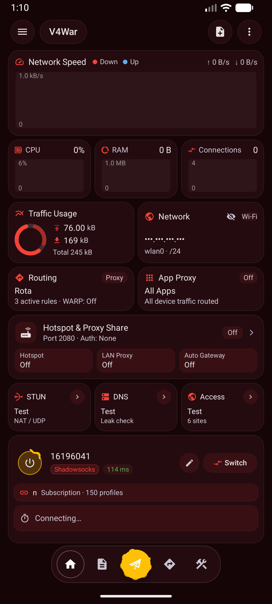
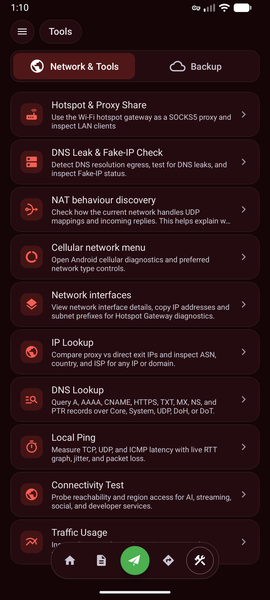
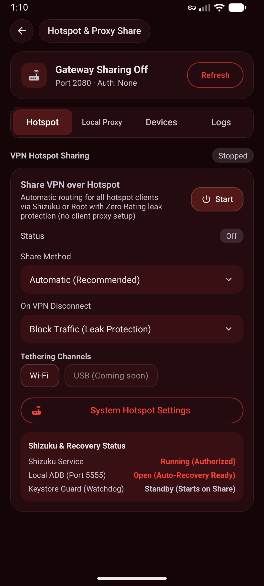

<div align="center">


# V4War for Android

**Yeni Nesil Android VPN ve Proxy İstemcisi · Sing-box & Xray Çekirdekli**

[🇬🇧 English](README.md) · [🇹🇷 Türkçe](README.tr.md)

<p>
  <a href="https://github.com/theyusa/V4War/actions/workflows/ci.yml"></a>
  <a href="https://github.com/theyusa/V4War/releases"></a>
  <a href="https://github.com/theyusa/V4War/releases"></a>
  <a href="LICENSE"></a>
</p>

<p>
  
  
  <a href="https://github.com/throneproj/ThroneForAndroid"></a>
  <a href="#-g%C3%BCnl%C3%BCk-upstream-senkronizasyonu"></a>
</p>

<p>
  <a href="https://v4war.theyusa.tr/">
    
  </a>
  <a href="https://github.com/theyusa/V4War/releases">
    
  </a>
</p>

</div>

> 🔀 **V4War**, [throneproj/ThroneForAndroid](https://github.com/throneproj/ThroneForAndroid) projesinin aktif olarak geliştirilen, kapsamlı bir çatalıdır (fork).
> Birleşik Sing-box ve Xray çekirdeğinin üzerine; **IP gizlemeli kompakt Bento Ana Ekran**, **gelişmiş Hotspot ve Proxy Paylaşım paketi (Shizuku TUN, Root `iptables` ve Rootsuz LAN Proxy)**, **10'u 1 Arada Ağ Araç Kutusu**, **Theme Studio destekli Material 3 Expressive arayüzü (Pure AMOLED)**, **profil bazlı Trafik Kullanımı, VPN sonrası `.srs` indirme, birleşik Uygulama Güncellemeleri** ve **varsayılan TLS kayıt parçalama (Fragment)** özelliklerini sunar.

<p align="center">
  <table>
    <tr>
      <td align="center"><b>Ana Ekran</b></td>
      <td align="center"><b>10'u 1 Arada Araçlar</b></td>
      <td align="center"><b>Hotspot ve Proxy Paylaşım</b></td>
    </tr>
    <tr>
      <td align="center"></td>
      <td align="center"></td>
      <td align="center"></td>
    </tr>
  </table>
</p>

---

## 📑 İçindekiler

- [Hotspot ve Proxy Paylaşım Paketi](#-hotspot-ve-proxy-payla%C5%9F%C4%B1m-paketi)
- [10'u 1 Arada Ağ Araç Kutusu ve Tanılama](#-10u-1-arada-a%C4%9F-ara%C3%A7-kutusu-ve-tan%C4%B1lama)
- [Material 3 Expressive Arayüz ve Theme Studio](#-material-3-expressive-aray%C3%BCz-ve-theme-studio)
- [Çekirdek, Güvenlik ve Akıllı Güncellemeler](#-çekirdek-güvenlik-ve-akıllı-güncellemeler)
- [Desteklenen Protokoller](#-desteklenen-protokoller)
- [Kurulum ve Derleme](#-kurulum-ve-derleme)
- [Günlük Upstream Senkronizasyonu](#-g%C3%BCnl%C3%BCk-upstream-senkronizasyonu)
- [Teşekkürler, SSS ve Lisans](#-te%C5%9Fekk%C3%BCrler)

---

## 🚀 Hotspot ve Proxy Paylaşım Paketi

Aktif VPN bağlantınızı **Wi-Fi Hotspot**, **USB RNDIS Paylaşımı** veya **Bluetooth PAN** üzerinden diğer telefonlar, bilgisayarlar ve cihazlarla **Root'lu veya Rootsuz** olarak paylaşın.

### Paylaşım Modları

| Mod | Yetki | Çalışma Mantığı | Öne Çıkanlar |
|---|---|---|---|
| **Otomatik (Auto)** | Uyarlanabilir | `Root → Shizuku → LAN Proxy` sırasıyla en uygun yöntemi seçer | Root veya Shizuku yoksa sorunsuz şekilde yedek moda geçer |
| **Shizuku** | Rootsuz (UID 2000) | AOSP `TestNetworkManager` + `TetheringManager` + `hev-socks5-tunnel` | Root olmadan gerçek şeffaf TUN paylaşımı, çift yığın (dual-stack) TUN, yukarı akış izleme (watchdog), ADB `127.0.0.1:5555` otomatik canlandırma, binder ölüm kurtarma |
| **Root** | `libsu` (Süper Kullanıcı) | Özel `iptables` zincirleri + `RootTetherHelper` otomatik tether | Tekilleştirilmiş kural yönetimi, IPv6 sızıntı önleme, VPN kopmasında yapılandırılabilir fail-closed koruması (`Trafiği Engelle` veya `Hotspot'u Durdur`) |
| **LAN Proxy** | Yetkisiz | Yerel `SOCKS5` / `HTTP` / `Mixed` port bağlama | V4War cihazları ve [theyusa/Throne](https://github.com/theyusa/Throne) masaüstü ile sıfır ayarlı eşleşme, isteğe bağlı parola, UDP-over-TCP (UoT), tek tıkla `socks5://` paylaşım linki |

### Çoklu Kanal ve Sistem Entegrasyonu

- 📡 **Wi-Fi Hotspot, USB RNDIS ve Bluetooth PAN:** Mobil erişim noktası, USB internet paylaşımı (RNDIS sıfırlama kurtarmalı) ve Bluetooth PAN desteği.
- 🎛️ **Hızlı Ayarlar (Quick Settings) Kutucuğu:** Android bildirim panelinden tek dokunuşla paylaşımı açıp kapatın (`HotspotShareTileService`), aktif kanal ve modu görün.
- 📊 **Canlı İstemci ve Trafik İzleme:** `TetherWatchService` paylaşılan veri trafiğini ve bağlı cihazları Clash API (`/connections`) + çekirdek ARP tablosuyla anlık takip eder.
- 🧾 **Çapraz Süreç Tanılama Log Çekmecesi:** Arka uç, `hev-socks5-tunnel`, Shizuku UserService ve Root kabuk loglarını doğrudan kompakt Material 3 çekmecesinde inceleyin.
- 💻 **Masaüstü ile Sıfır Yapılandırma:** Bilgisayarınızda [theyusa/Throne](https://github.com/theyusa/Throne) çalıştırıp telefonun hotspot'una bağlanın ve masaüstünde `Settings → Basic Settings → Hotspot Ağ Geçidi` ayarını açın — IP veya port yazmaya gerek yoktur.

<details>
<summary>📸 Önizleme: LAN Paylaşımı ve Hotspot Ağ Geçidi Ekranı</summary>

<p align="center">
  
</p>

</details>

---

## 🧰 10'u 1 Arada Ağ Araç Kutusu ve Tanılama

**Araçlar → Ağ** sekmesinde Material 3 Expressive grafiklerle sunulan on yerleşik ağ tanılama aracı:

| Araç | Özellikler |
|---|---|
| **Hotspot ve Proxy Paylaşımı** | Auto / Shizuku / Root / LAN Proxy yönetimi, Wi-Fi / USB / Bluetooth tethering, bağlı cihazlar ve log çekmecesi |
| **DNS Sızıntı ve Fake-IP Testi** | İstemci genel çıkış IP'sini DNS çözücü çıkışıyla karşılaştırır, Fake-IP / Strict Route yalıtımını ve Sistem Özel DNS (DoT) durumunu doğrular |
| **STUN NAT Davranış Keşfi** | Saf Kotlin **RFC 5389 / 5780** NAT sınıflandırıcısı (Open, Full-Cone, Restricted-Cone, Port-Restricted-Cone, Symmetric), RTT/jitter/kayıp metrikleri, özel sunucu profilleri ve **fiziksel ağ üzerinden VPN bypass testi** |
| **IP Sorgulama ve Çıkış Karşılaştırması** | **Proxy Çıkışı vs Doğrudan Fiziksel Çıkış** karşılaştırması ile herhangi bir IP, alan adı veya URL için ASN, ISS, ülke, saat dilimi ve IP sınıfı analizi |
| **DNS Sorgulama (Lookup)** | Çekirdek, Sistem DNS veya özel çözücüler (`UDP`, `DoH`, `DoT`) üzerinden `A`, `AAAA`, `CNAME`, `HTTPS`, `TXT`, `MX`, `NS` ve `PTR` kayıtlarını çoklu karşılaştırmayla sorgulama |
| **Yerel Ping** | Canlı RTT zaman çizelgesi grafiği, min/ort/maks, jitter, paket kaybı ve doğrudan fiziksel ağ seçeneği ile `TCP`, `UDP` ve `ICMP` gecikme ölçümü |
| **Bağlantı ve Platform Testi** | **Yapay Zeka** (ChatGPT, Claude, Gemini, Grok, Perplexity, OpenRouter), **Yayın** (Netflix, YouTube, Disney+, Spotify, Twitch, TikTok), **Sosyal** (Telegram, Discord, X, Reddit) ve **Geliştirici** (GitHub, Cloudflare, Google, Wikipedia, Docker, npm) erişilebilirlik testi |
| **Canlı Ağ Arayüzleri** | Aktif ağ ve sistem DNS özeti, IPv4/IPv6 adresleri, alt ağ maskeleri, MTU, MAC, yönlendirme tabloları ve hotspot/tether arayüz tespiti |
| **Trafik Kullanım Analizi** | Anlık proxy/doğrudan hız, oturum ve uygulama UID toplamları, görsel trafik çubukları ve profil/grup bazlı kullanım istatistikleri |
| **Hücresel Ağ Menüsü** | Android radyo tanılama ekranlarına (Radio Info) ve tercih edilen ağ türü (LTE / NR 5G sabitleme) kontrollerine hızlı erişim |

---

## 🎨 Material 3 Expressive Arayüz ve Theme Studio

- **Theme Studio (`Ayarlar → Görünüm`):** Canlı etkileşimli mini önizleme kartı ile 5 yüzey modu — **Pure AMOLED**, **AMOLED**, **Koyu**, **Açık** ve **Sistem**.
- **3 Tonlu Tohum Renk Uyumu:** Material 3 ton paleti, özel tema tohumları, Android 12+ **Monet** dinamik renklendirme ve uyumlu iletişim kutuları, anahtarlar ve squircle ikon rozetleri.
- **Modern Liste ve Gezinme:** Yüzen hap (floating pill) başlıklar, expressive sekme göstergeleri, protokol rozetleri, kompakt profil satırları ve kompakt grup kartları.

---

## 🔒 Çekirdek, Güvenlik ve Akıllı Güncellemeler

- **Varsayılan TLS Kayıt Parçalama (Fragment):** Sahte SNI ve CDN fronting senaryolarında dayanıklılık için varsayılan olarak etkinleştirilmiştir.
- **Shizuku ile Sessiz Güncelleme:** `v4war-update.json` üzerinden SHA-256 ve imza sertifikası doğrulamalı güncelleme denetleyicisi; `CHANGELOG.md` sürüm notları, isteğe bağlı GitHub token desteği, Obtainium uyumu ve **Shizuku üzerinden sessiz arka plan kurulumu** (`UpdateUserService`).
- **Gruplar, Yönlendirme ve Yedekler:** Grup bazlı yönlendirme profilleri, Happ yönlendirme içe aktarma, özel abonelik SNI, yönlendirme proxy atlamaları, çoklu grup Otomatik Seçici, Cloudflare WARP (WireGuard & MASQUE), WebDAV senkronizasyonlu `.thrbackup` yedekleri ve otomatik gizli veri temizliği (`HotspotBackupSanitizer`).
- **Sistem ve Android TV Desteği:** Ana ekran widget'ları, Hızlı Ayarlar kutucukları, bildirim çubuğu eylemleri ve D-pad kumanda destekli yerel Android TV deneyimi.

---

## 🔌 Desteklenen Protokoller

| | | | |
|---|---|---|---|
| 🧦 SOCKS5 | 🌐 HTTP(S) | 🛡️ Shadowsocks | 🐴 Trojan |
| 💬 VMess | ✉️ VLESS | ⚡ Xray VLESS | 🚀 TUIC |
| 🌀 Hysteria 1/2 | 🔗 AnyTLS | 🪨 Mieru | 🐚 Snell |
| 🦋 NaïveProxy | 🍹 Juicity | 🚇 TrustTunnel | 🎭 ShadowTLS |
| 🔐 WireGuard | 🔐 AmneziaWG | 🎭 MASQUE | 🔑 SSH |
| 🔒 OpenVPN | 🔓 OpenConnect | ➡️ Direct | ⛓️ Chain |
| 🧩 Özel Çıkış | ✨ Otomatik Seçici | 📡 DNSTT / VayDNS | 🎯 MasterDNS |

**Abonelik Biçimleri:** Standart paylaşım linkleri, Sing-box JSON, v2rayN, Shadowsocks, Clash (çıkış içe aktarma) ve deeplink desteği ([dokümantasyon](https://throneproj.github.io/advanced/deeplinks/)).

---

## 📦 Kurulum ve Derleme

### Hazır APK İndirme

Cihazınızın işlemci mimarisine uygun APK'yı [**GitHub Releases**](https://github.com/theyusa/V4War/releases) sayfasından indirin:

| Mimari | Hedef Cihazlar |
|---|---|
| `arm64-v8a` | Modern Android telefon ve tabletlerin çoğu (2015+) |
| `armeabi-v7a` | Eski 32-bit ARM cihazlar |
| `x86_64` | Emülatörler ve x86_64 Android cihazlar |

### Kaynak Koddan Derleme ve Test

**JDK 17 veya 21** ile **Android SDK 35** (`buildToolsVersion = "35.0.1"`, `minSdk = 24`) gerektirir:

```bash
# JVM birim testlerini çalıştırın
./gradlew :app:testOssDebugUnitTest

# Debug APK derleyin (app/libs/ altında ThroneCore AAR gerektirir)
./gradlew :app:assembleOssDebug
```

> CI iş akışı `.github/actions/` üzerinden `ThroneCore`, `routeprofiles` ve `sing-box-dashboard` bileşenlerini otomatik indirir. Ayrıntılar için [CONTRIBUTING.md](CONTRIBUTING.md) dosyasına bakın.

---

## 🔄 Günlük Upstream Senkronizasyonu

Bu depo, [`.github/workflows/sync-upstream.yml`](.github/workflows/sync-upstream.yml) iş akışı ile ana kaynak [throneproj/ThroneForAndroid](https://github.com/throneproj/ThroneForAndroid) ile senkronize kalır:

- 🕒 Her gün **03:00 UTC** saatinde (veya manuel tetikleme ile) çalışır.
- 🔍 Fork commit'lerini `upstream/main` üzerine (`--no-tags --empty=drop`) rebase eder ve `main` dalına göndermeden önce `:app:testOssDebugUnitTest` testlerini doğrular.
- 🏷️ Özel Git birleştirme sürücüleri (`.gitattributes`) V4War kimliğini, belgeleri, CI dosyalarını ve sürüm bilgilerini korur.

---

## 🙏 Teşekkürler

Açık kaynak topluluğunun değerli projeleri üzerine inşa edilmiştir:

- **Upstream:** [throneproj/ThroneForAndroid](https://github.com/throneproj/ThroneForAndroid)
- **Çekirdekler:** [throneproj/sing-box](https://github.com/throneproj/sing-box) & [throneproj/Xray-core](https://github.com/throneproj/Xray-core)
- **Rootsuz TUN Motoru:** [heiher/hev-socks5-tunnel](https://github.com/heiher/hev-socks5-tunnel)
- **Yetki ve Kabuk Çatıları:** [RikkaApps/Shizuku](https://github.com/RikkaApps/Shizuku) & [topjohnwu/libsu](https://github.com/topjohnwu/libsu)
- **GUI Kökleri:** [MatsuriDayo/NekoBoxForAndroid](https://github.com/MatsuriDayo/NekoBoxForAndroid), [SagerNet/SagerNet](https://github.com/SagerNet/SagerNet) & [shadowsocks/shadowsocks-android](https://github.com/shadowsocks/shadowsocks-android)
- **Ağ Araçları İlhamı:** [eleutherifer/NekoBoxPlus](https://github.com/eleutherifer/NekoBoxPlus) & [ccding/go-stun](https://github.com/ccding/go-stun)
- **Masaüstü Eşi:** [theyusa/Throne](https://github.com/theyusa/Throne) & [throneproj/Throne](https://github.com/throneproj/Throne)

---

## ❓ Sıkça Sorulan Sorular (SSS)

**Root olmadan VPN bağlantımı nasıl paylaşırım?** <br/>
**Araçlar → Ağ → Hotspot ve Proxy Paylaşımı** ekranını açın. Bağlanan cihazlarda hiçbir proxy ayarı yapmadan sistem geneli şeffaf TUN paylaşımı için **Shizuku** modunu (Wi-Fi Hotspot, USB ve Bluetooth destekli), veya `SOCKS5`/`HTTP` linki paylaşmak için **LAN Proxy** modunu seçin.

**Bilgisayarımla IP/Port girmeden nasıl VPN paylaşırım?** <br/>
Windows veya Linux bilgisayarınıza [theyusa/Throne](https://github.com/theyusa/Throne) kurun, telefonun hotspot ağına bağlanın ve masaüstü ayarlarından **Settings → Basic Settings → Hotspot Ağ Geçidi** seçeneğini açın. Bilgisayar otomatik bağlanır.

**Hata veya güvenlik açığı nasıl bildirilir?** <br/>
Hata ve özellik talepleri için [GitHub Issue Şablonlarını](https://github.com/theyusa/V4War/issues/new/choose), güvenlik bildirimleri için [SECURITY.md](SECURITY.md) yönergelerini kullanın.

---

## 📜 Lisans

**GNU General Public License v3.0** altında dağıtılmaktadır — tüm koşullar için [LICENSE](LICENSE) dosyasına bakın.
