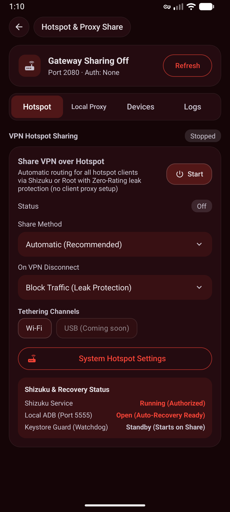

# Hotspot & Proxy Share (Shizuku & Root)

Open **Tools → Network → Hotspot & Proxy Share** to turn your Android device into a transparent VPN gateway for laptops, phones, tablets, and gaming consoles.

## Sharing backends compared

| Mode | Privilege | How It Works | Key Advantages |
|---|---|---|---|
| **Auto** | Adaptive | Evaluates privileges on start and selects `Root → Shizuku → LAN Proxy` | Zero manual switching; falls back safely if Root/Shizuku stops |
| **Shizuku (Rootless)** | **UID 2000** | Uses AOSP `TestNetworkManager` + `TetheringManager` + `hev-socks5-tunnel` | **True transparent TUN tethering without Root** — client devices need zero proxy setup |
| **Root (`iptables`)** | Superuser (`libsu`) | Kernel `iptables` / `ip6tables` NAT & forwarding + `RootTetherHelper` | Idempotent rule deduplication, IPv6 leak blocking, kernel-speed forwarding |
| **LAN Proxy** | None | Local `HTTP` / `SOCKS5` inbound listener (`Port 2080` default) | Works on any device without Shizuku or Root |

## Step-by-step: Rootless Shizuku TUN sharing

1. Install and start **Shizuku** (via Wireless Debugging or USB ADB `adb tcpip 5555`).
2. Start your active VPN tunnel in V4War.
3. Open **Tools → Network → Hotspot & Proxy Share → Hotspot**.
4. Under **Share Method**, select **Shizuku (Rootless)** (or **Auto**).
5. Pick your **Tethering Channel**: **Wi-Fi**, **USB** (RNDIS with automatic reset/recovery hardening), or **Bluetooth** (PAN), or tap **System Hotspot Settings** to enable your phone's hotspot.
6. Toggle **Share VPN over Hotspot** ON.

### Shizuku & Recovery Status panel

At the bottom of the Hotspot tab, V4War monitors three resilience subsystems:

- **Shizuku Service** — Shows live authorization state (`Running (Authorized)`).
- **Local ADB (Port 5555)** — `Open (Auto-Recovery Ready)` allows V4War to automatically revive Shizuku if Android terminates the binder.
- **Keystore Guard (Watchdog)** — `Standby (Starts on Share)` watches upstream interface drift and restores routing automatically.

## Zero-Rating leak protection (Fail-Closed)

Under **On VPN Disconnect**, choose **Block Traffic (Leak Protection)** (or **Stop Hotspot**) so connected clients can never accidentally fall back to your carrier's direct cellular data if the VPN drops.

## Quick Settings integration

Add the **Hotspot Share** tile (`HotspotShareTileService`) to your Android Quick Settings panel to start/stop tethering and inspect the active channel without leaving your current app.
