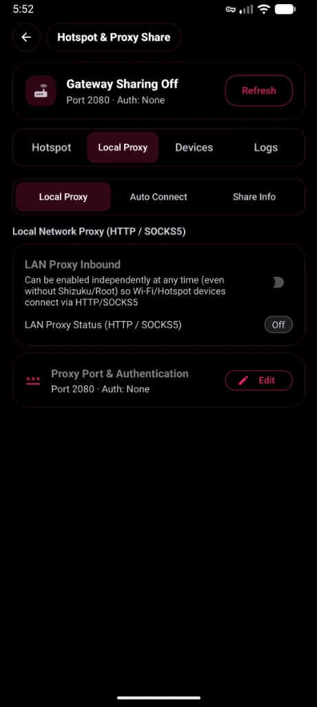
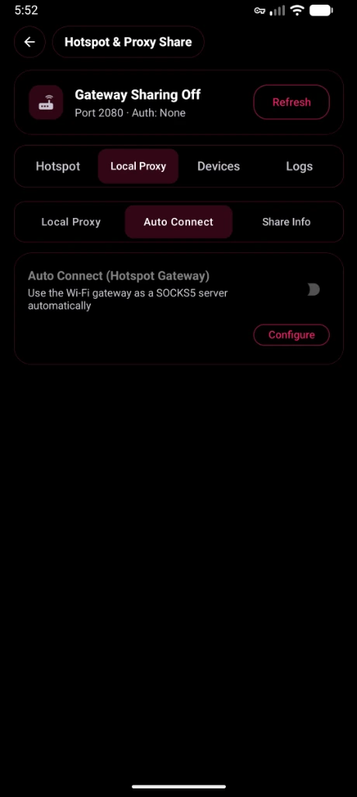
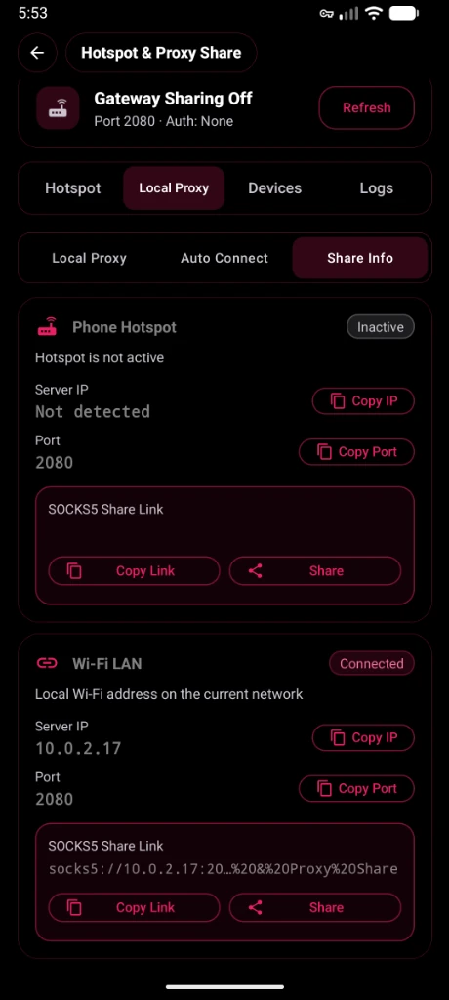
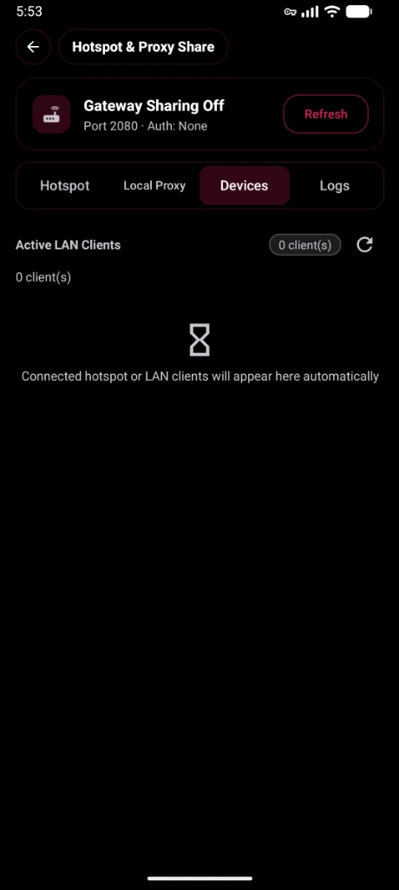
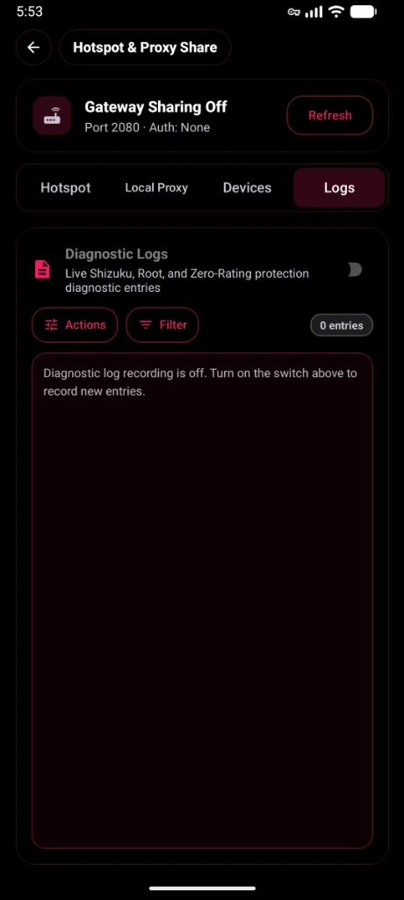

# Local Proxy, Auto Connect & Share Info

Even on devices without Root or Shizuku, V4War's **Local Proxy** tab lets any device on your Wi-Fi or Hotspot route traffic through your phone's active tunnel.

## LAN Proxy Inbound (HTTP / SOCKS5)

1. Switch to **Local Proxy → Local Proxy**.
2. Enable **LAN Proxy Inbound** — works independently at any time without Shizuku or Root.
3. Tap **Edit** on **Proxy Port & Authentication** to customize the listening port (default `2080`) or add a username/password.
4. Supports **UDP-over-TCP (UoT)** and standard `HTTP` / `SOCKS5` clients.

## Auto Connect (Hotspot Gateway) & Desktop Pairing

Use **Auto Connect (Hotspot Gateway)** to automatically turn a Wi-Fi gateway into a SOCKS5 server with zero manual IP or port entry:

- **Phone → Desktop ([theyusa/Throne](https://github.com/theyusa/Throne)):** Connect your Windows or Linux PC to your phone's hotspot and enable **Settings → Basic Settings → Hotspot Gateway** on desktop. Throne discovers the phone gateway automatically.
- **Phone → Phone (V4War Client):** Enable **Auto Connect (Hotspot Gateway)** and tap **Configure** so the secondary Android device automatically connects via the hotspot gateway's SOCKS5 server.

## Share Info & One-Tap SOCKS5 Links

The **Share Info** sub-tab detects both interfaces separately:

- **Phone Hotspot** — Displays the active hotspot subnet IP and port when tethering is active.
- **Wi-Fi LAN** — Displays your current local Wi-Fi IP (e.g. `10.0.2.17:2080`) with **Copy IP**, **Copy Port**, **Copy Link**, and **Share** (`socks5://...`) buttons.

## Connected Devices & Diagnostic Logs

- **Devices** — `TetherWatchService` merges Clash API (`/connections`) telemetry with the kernel ARP neighbor table to list active hotspot and LAN clients in real time.

- **Logs** — Toggle **Diagnostic Logs** to record live events from Shizuku UserService, Root shell, `hev-socks5-tunnel`, and Zero-Rating leak protection, complete with **Actions** (export/clear) and **Filter** controls.
