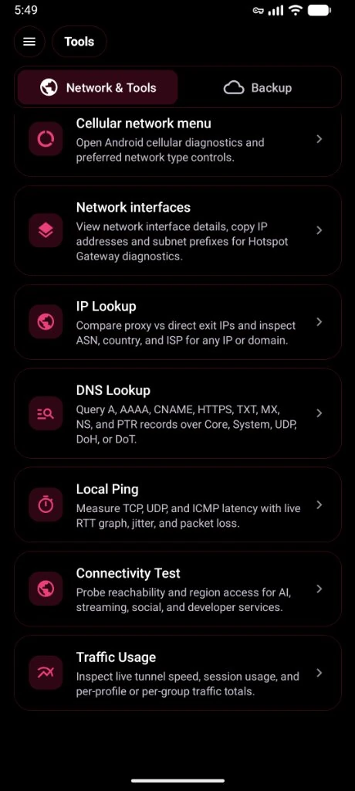

# 10-in-1 Network Toolbox

Open **Tools → Network & Tools** from the navigation drawer to access ten built-in diagnostic engines styled with Material 3 Expressive charts and side-by-side comparison cards.

## Diagnostic engines reference

| Tool | What It Inspects | Key Highlights |
|---|---|---|
| **Hotspot & Proxy Share** | VPN tethering & LAN sharing | Auto / Shizuku TUN / Root iptables / LAN Proxy, devices & logs |
| **Cellular network menu** | Android radio & preferred band | Launches modern/legacy `RadioInfo` diagnostics and LTE / NR 5G pinning (dual-SIM aware) |
| **Network interfaces** | Active kernel interfaces & DNS | Inspects `tun0`, `wlan0`, `wlan1`, `rndis0`, IPv4/IPv6 prefixes, MTU, MAC, flags, and System DNS |
| **IP Lookup** | Proxy vs Direct exit comparison | Side-by-side Proxy Exit vs Direct Physical Exit check with ASN, ISP, country, timezone, and IP class |
| **DNS Lookup** | Multi-resolver record inspection | Query `A`, `AAAA`, `CNAME`, `HTTPS`, `TXT`, `MX`, `NS`, and `PTR` across Core, System, UDP, DoH, or DoT |
| **Local Ping** | `TCP`, `UDP`, and `ICMP` latency | Real-time RTT graph, min/avg/max, jitter, packet loss, plus direct physical network bypass toggle |
| **Connectivity Test** | Service & region reachability | Probes 24+ **AI** (ChatGPT, Claude, Gemini, Grok), **Streaming** (Netflix, YouTube, Disney+), **Social**, and **Developer** platforms |
| **Traffic Usage** | Live speed & quota analytics | Live tunnel speed, session vs app UID vs device totals, visual traffic bars, and per-profile/group history |
| **DNS Leak & Fake-IP Check** | DNS & routing isolation | Compares client public egress vs DNS resolver egress, audits Fake-IP (`198.18.0.0/15`), and checks System Private DNS (DoT) |
| **STUN NAT Behaviour** | Pure Kotlin RFC 5389 / 5780 | Classifies NAT Mapping & Filtering (Open, Full-Cone, Symmetric), measures RTT/jitter/loss, and supports physical VPN bypass |

## Recommended diagnostic workflow

1. Start with **IP Lookup** to confirm your Proxy Exit differs from your Direct Physical Exit.
2. Run **DNS Leak & Fake-IP Check** if websites still resolve to your ISP's DNS or block regions.
3. Run **Connectivity Test** to check whether AI or streaming platforms accept your current exit IP and region.
4. Use **Network interfaces** when troubleshooting Hotspot Gateway IP prefixes or USB RNDIS detection.
