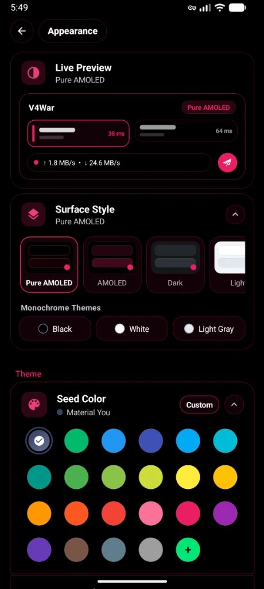

# Appearance & Theme Studio

Open **Settings → Appearance** (or try the interactive **[Theme Studio](/theme-studio)** right here on the website) to customize V4War's Material 3 Expressive interface.

## Live Preview card

At the top of **Appearance**, the always-open **Live Preview** card shows an interactive miniature rendering of V4War's profile grid, active mode badge (e.g. `Pure AMOLED`), selected card accent bar + `38 ms` / `64 ms` latency chips, live `↑ / ↓` stats pill, and connect FAB.

## Surface Styles

| Surface Style | Canvas & Card Treatment | Best For |
|---|---|---|
| **Pure AMOLED** | `#000000` canvas + `#000000` cards + `0.5dp` tinted hairline stroke | OLED battery saving & ultra-clean contrast |
| **AMOLED** | `#000000` canvas + seed-tinted elevated cards (`11%` blend) | Deep blacks with distinct card elevation |
| **Dark** | Material 3 **3-Tone** dark canvas, elevated container, and nested surface | Balanced low-glare dark mode |
| **Light** | Tinted light canvas with crisp white elevated cards | Bright daylight readability |
| **System** | Follows Android's day/night schedule automatically | Automatic day/night switching |

## Monochrome Themes

Under **Monochrome Themes**, pick **Black**, **White**, or **Light Gray** for a pure grayscale experience without chromatic accent colors. Selecting any colorful seed restores your seed palette automatically.

## Seed Color & Custom HEX

- **Material You** — On Android 12+, dynamically extracts your wallpaper palette via Monet.
- **21 Curated Presets** — From **Verdant Mint** (default) to Blue, Indigo, Cyan, Amber, Flame Red, Sakura Pink, and Deep Purple.
- **Custom** — Tap **Custom** (or the `+` swatch) to dial any exact **HEX** code or **R / G / B** channel slider.

## Profile list & notification layout

- **Compact profile rows** — Shows each profile on a single line with name and latency; use `⋮ → Edit` or `Share` for actions.
- **Compact group cards** — Shows subscription traffic bar and expiry countdown instead of full URLs.
- **Show config security / Always show address** — Toggle security protocol badges and server addresses on cards.
