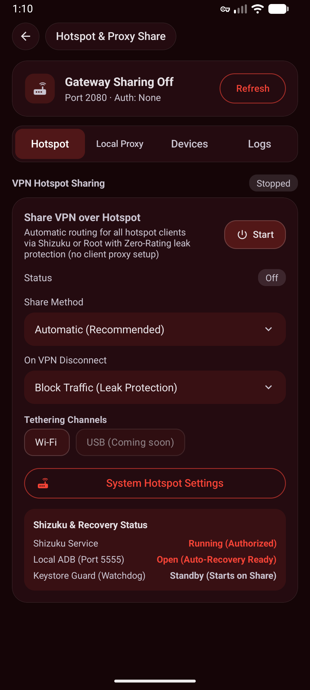

# Hotspot ve Proxy Paylaşım (Shizuku & Root)

Android cihazınızı dizüstü bilgisayarlar, telefonlar, tabletler ve oyun konsolları için şeffaf bir VPN ağ geçidine dönüştürmek üzere **Araçlar → Ağ → Hotspot ve Proxy Paylaşımı** ekranını açın.

## Paylaşım modlarının karşılaştırması

| Mod | Yetki | Çalışma Mantığı | Öne Çıkanlar |
|---|---|---|---|
| **Auto (Otomatik)** | Uyarlanabilir | Başlatmada yetkileri denetler ve `Root → Shizuku → LAN Proxy` sırasıyla en uygun motoru seçer | Manuel geçiş gerektirmez; Root/Shizuku durursa yedek moda geçer |
| **Shizuku (Rootsuz)** | **UID 2000** | AOSP `TestNetworkManager` + `TetheringManager` + `hev-socks5-tunnel` | **Root olmadan gerçek şeffaf TUN paylaşımı** — bağlanan cihazda proxy ayarı gerekmez |
| **Root (`iptables`)** | Süper Kullanıcı (`libsu`) | Çekirdek düzeyinde `iptables` / `ip6tables` NAT yönlendirmesi + `RootTetherHelper` | Tekilleştirilmiş kural yönetimi, IPv6 sızıntı engelleme, çekirdek hızında aktarım |
| **LAN Proxy** | Ek İzin Yok | Yerel `HTTP` / `SOCKS5` giriş soketi (varsayılan `Port 2080`) | Shizuku veya Root olmadan her cihazda çalışır |

## Adım adım: Rootsuz Shizuku TUN paylaşımı

1. **Shizuku** uygulamasını Kablosuz Hata Ayıklama veya USB ADB (`adb tcpip 5555`) ile başlatın.
2. V4War içinde aktif VPN tünelinizi başlatın.
3. **Araçlar → Ağ → Hotspot ve Proxy Paylaşımı → Hotspot** sekmesini açın.
4. **Paylaşım Yöntemi (Share Method)** alanından **Shizuku (Rootless)** (veya **Auto**) seçeneğini seçin.
5. **Tethering Kanalları** bölümünden **Wi-Fi**, **USB** (otomatik RNDIS sıfırlama/kurtarmalı) veya **Bluetooth** seçin ya da **System Hotspot Settings** düğmesiyle telefonunuzun erişim noktasını açın.
6. **Share VPN over Hotspot** anahtarını etkinleştirin.

### Shizuku & Recovery Status paneli

Hotspot sekmesinin altındaki durum kutusu üç kurtarma bileşenini canlı izler:

- **Shizuku Service** — Anlık yetkilendirme durumunu gösterir (`Running (Authorized)`).
- **Local ADB (Port 5555)** — `Open (Auto-Recovery Ready)` açık olduğunda Android binder'ı sonlandırsa bile V4War Shizuku'yu otomatik canlandırır.
- **Keystore Guard (Watchdog)** — `Standby (Starts on Share)` yukarı akış arayüz sapmalarını izler ve yönlendirmeyi otomatik onarır.

## Zero-Rating sızıntı koruması (Fail-Closed)

**On VPN Disconnect** menüsünden **Block Traffic (Leak Protection)** (veya **Stop Hotspot**) seçeneğini belirleyerek VPN koptuğunda bağlı istemcilerin yanlışlıkla doğrudan mobil veriye düşmesini engelleyin.

## Hızlı Ayarlar entegrasyonu

Android bildirim panelinize **Hotspot Share** kutucuğunu (`HotspotShareTileService`) ekleyerek uygulamaya girmeden paylaşımı tek dokunuşla başlatıp durdurabilirsiniz.
