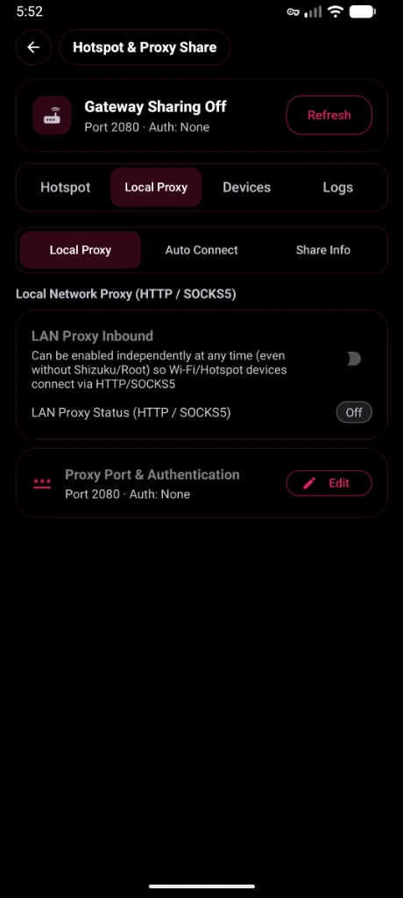
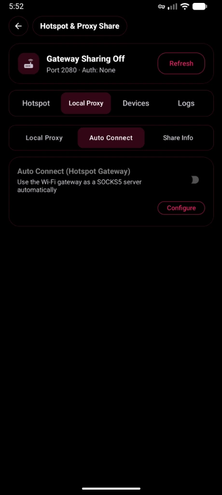
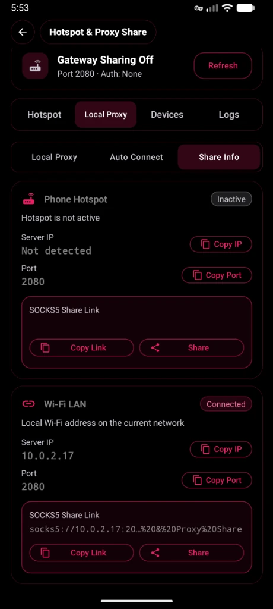
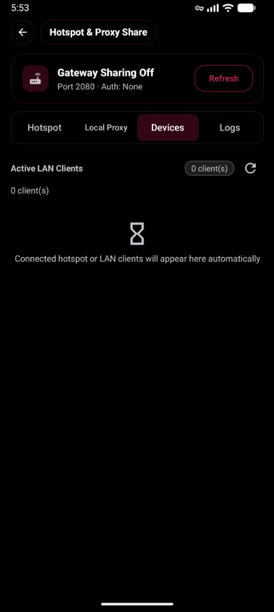
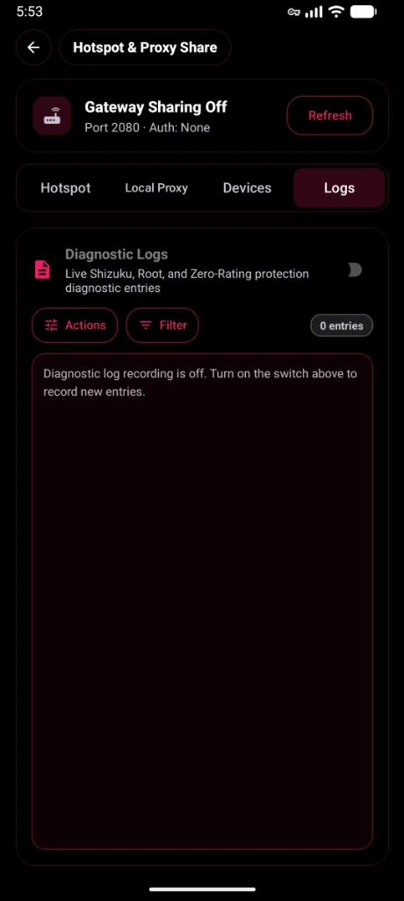

# Yerel Proxy, Otomatik Bağlan ve Paylaşım

Root veya Shizuku bulunmayan cihazlarda bile **Local Proxy** sekmesi sayesinde aynı Wi-Fi veya Hotspot ağındaki cihazlar telefonunuzun VPN tünelini kullanabilir.

## LAN Proxy Inbound (HTTP / SOCKS5)

1. **Local Proxy → Local Proxy** sekmesine geçin.
2. **LAN Proxy Inbound** anahtarını açın — Shizuku veya Root olmadan her zaman bağımsız çalışır.
3. Dinleme portunu (varsayılan `2080`) veya kullanıcı adı/parola doğrulamasını değiştirmek için **Proxy Port & Authentication → Edit** düğmesine dokunun.
4. **UDP-over-TCP (UoT)** ve standart `HTTP` / `SOCKS5` istemcilerini destekler.

## Auto Connect (Hotspot Gateway) ve Masaüstü Eşleşmesi

**Auto Connect (Hotspot Gateway)** ile IP veya port yazmadan Wi-Fi ağ geçidini otomatik olarak SOCKS5 sunucusu şeklinde kullanabilirsiniz:

- **Telefon → Masaüstü ([theyusa/Throne](https://github.com/theyusa/Throne)):** Windows veya Linux bilgisayarınızı telefonunuzun hotspot ağına bağlayın ve masaüstü ayarlarından **Settings → Basic Settings → Hotspot Ağ Geçidi** seçeneğini açın. Throne telefonu otomatik bulur.
- **Telefon → Telefon (V4War İstemcisi):** İkinci Android cihazda **Auto Connect (Hotspot Gateway)** anahtarını açıp **Configure** ile hotspot ağ geçidine otomatik bağlanın.

## Share Info ve Tek Dokunuşla SOCKS5 Bağlantısı

**Share Info** alt sekmesi iki arayüzü ayrı ayrı algılar:

- **Phone Hotspot** — Paylaşım aktifken telefonun hotspot alt ağ IP'sini ve portunu gösterir.
- **Wi-Fi LAN** — Bağlı olduğunuz yerel Wi-Fi IP'sini (ör. `10.0.2.17:2080`) **Copy IP**, **Copy Port**, **Copy Link** ve **Share** (`socks5://...`) düğmeleriyle sunar.

## Bağlı Cihazlar ve Tanılama Logları

- **Devices** — `TetherWatchService`, Clash API (`/connections`) verileri ile çekirdek ARP tablosunu birleştirerek bağlı hotspot ve LAN istemcilerini canlı listeler.

- **Logs** — Shizuku UserService, Root kabuk, `hev-socks5-tunnel` ve Zero-Rating koruma olaylarını kaydetmek için **Diagnostic Logs** anahtarını açın; **Actions** ve **Filter** ile kayıtları inceleyin.
