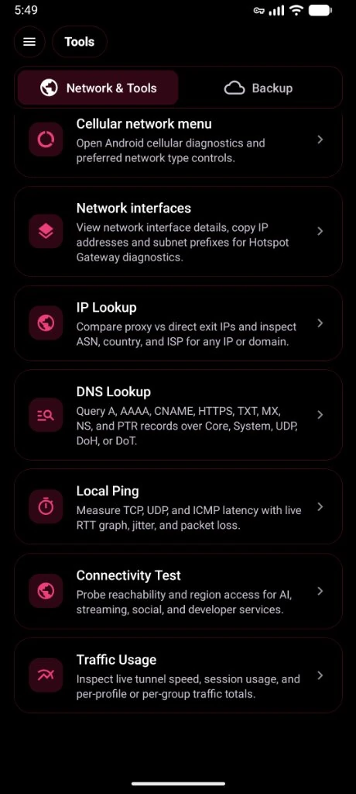

# 10'u 1 Arada Ağ Araç Kutusu

Material 3 Expressive grafikler ve yan yana karşılaştırma kartlarıyla sunulan on yerleşik tanılama motoruna yan çekmeceden **Araçlar → Ağ ve Araçlar** yoluyla ulaşabilirsiniz.

## Tanılama motorları rehberi

| Araç | Neyi İnceler | Öne Çıkanlar |
|---|---|---|
| **Hotspot & Proxy Share** | VPN paylaşımı ve LAN proxy | Auto / Shizuku TUN / Root iptables / LAN Proxy, cihazlar ve loglar |
| **Cellular network menu** | Android radyo ve ağ bandı | Modern/klasik `RadioInfo` tanılama ekranı ve LTE / NR 5G sabitleme (çift SIM uyumlu) |
| **Network interfaces** | Çekirdek ağ arayüzleri ve DNS | `tun0`, `wlan0`, `wlan1`, `rndis0`, IPv4/IPv6 önekleri, MTU, MAC, bayraklar ve Sistem DNS |
| **IP Lookup** | Proxy vs Doğrudan çıkış kıyası | Proxy Çıkışı ile Doğrudan Fiziksel Çıkış IP'sini, ASN, ISS, ülke ve saat dilimini yan yana inceler |
| **DNS Lookup** | Çoklu çözücü kayıt sorgusu | Çekirdek, Sistem, UDP, DoH veya DoT üzerinden `A`, `AAAA`, `CNAME`, `HTTPS`, `TXT`, `MX`, `NS` ve `PTR` |
| **Local Ping** | `TCP`, `UDP` ve `ICMP` gecikme | Canlı RTT zaman çizelgesi, min/ort/maks, jitter, paket kaybı ve doğrudan fiziksel ağ atlama anahtarı |
| **Connectivity Test** | Servis ve bölge erişim testi | 24+ **Yapay Zeka** (ChatGPT, Claude, Gemini, Grok), **Yayın** (Netflix, YouTube, Disney+), **Sosyal** ve **Geliştirici** platformu |
| **Traffic Usage** | Anlık hız ve kota analizi | Canlı tünel hızı, oturum / uygulama UID / cihaz toplamları, görsel trafik çubukları ve profil geçmişi |
| **DNS Leak & Fake-IP Check** | DNS ve yönlendirme yalıtımı | Genel çıkış IP'si ile DNS çözücü çıkışını kıyaslar, Fake-IP (`198.18.0.0/15`) ve Sistem Özel DNS'i denetler |
| **STUN NAT Behaviour** | Saf Kotlin RFC 5389 / 5780 | NAT Mapping & Filtering tipini (Open, Full-Cone, Symmetric) ve RTT/jitter/kayıp oranını ölçer |

## Önerilen tanılama sırası

1. Proxy çıkışınızın fiziksel ISS IP'nizden ayrıldığını doğrulamak için **IP Lookup** çalıştırın.
2. Siteler hâlâ ISS DNS'inizi görüyorsa **DNS Leak & Fake-IP Check** ile sızıntı olup olmadığını kontrol edin.
3. AI veya yayın servislerinin mevcut çıkış IP'nizi ve bölgenizi kabul edip etmediğini **Connectivity Test** ile ölçün.
4. Hotspot Gateway alt ağ öneklerini veya USB RNDIS arayüzünü kontrol etmek için **Network interfaces** ekranını kullanın.
