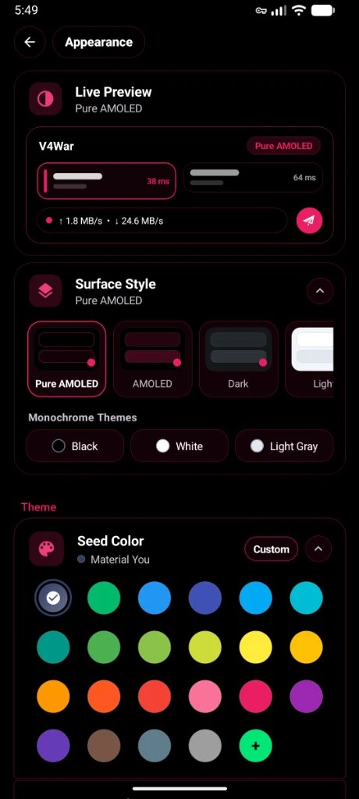

# Görünüm ve Theme Studio

V4War'ın Material 3 Expressive arayüzünü özelleştirmek için **Ayarlar → Görünüm** ekranını açın (veya doğrudan bu sitedeki etkileşimli **[Theme Studio](/theme-studio)** sayfasında deneyin).

## Live Preview (Canlı Önizleme) kartı

**Görünüm** ekranının en üstündeki **Live Preview** kartı, aktif mod rozetini (`Pure AMOLED`), seçili profil kartının vurgu çubuğunu + `38 ms` / `64 ms` gecikme etiketlerini, alt hız çubuğunu (`↑ 1.8 MB/s • ↓ 24.6 MB/s`) ve bağlan düğmesini (FAB) anlık olarak gösterir.

## Yüzey Stilleri (Surface Style)

| Yüzey Stili | Tuval ve Kart Yapısı | En Uygun Kullanım |
|---|---|---|
| **Pure AMOLED** | `#000000` tuval + `#000000` kartlar + `0.5dp` ince çizgi kenarlık | OLED pil tasarrufu ve saf siyah kontrast |
| **AMOLED** | `#000000` tuval + tohum rengi harmanlı (`%11`) yükseltilmiş kartlar | Siyah zemin üzerinde belirgin kart derinliği |
| **Dark (Koyu)** | Material 3 **3-Tonlu** koyu tuval, yükseltilmiş kart ve iç kutu | Dengeli koyu mod görünümü |
| **Light (Açık)** | Hafif tonlu açık tuval üzerinde net beyaz kartlar | Gün ışığında yüksek okunabilirlik |
| **System (Sistem)** | Android'in gündüz/gece moduna otomatik uyum sağlar | Otomatik tema geçişi |

## Monokrom Temalar (Monochrome Themes)

**Monochrome Themes** altından **Black**, **White** veya **Light Gray** seçerek renkli vurgular olmadan saf gri/siyah-beyaz bir arayüz elde edebilirsiniz. Herhangi bir renkli tohum seçtiğinizde renkli palet otomatik olarak geri yüklenir.

## Tohum Rengi (Seed Color) ve Özel HEX

- **Material You** — Android 12+ cihazlarda duvar kağıdınızdan Monet dinamik paleti üretir.
- **21 Seçilmiş Hazır Renk** — Varsayılan **Verdant Mint** (Nane Yeşili) dahil 21 hazır palet.
- **Custom (Özel)** — **Custom** düğmesine (veya `+` dairesine) dokunarak dilediğiniz **HEX** kodunu ya da **R / G / B** kaydırıcılarını ayarlayın.

## Profil listesi ve bildirim düzeni

- **Kompakt profil satırları** — Her profili tek satırda yalnızca ad ve gecikme ile gösterir (`⋮ → Düzenle` veya `Paylaş`).
- **Kompakt grup kartları** — Abonelik kartlarında uzun URL yerine kullanım çubuğu ve kalan süre gösterir.
- **Yapılandırma güvenliğini göster / Adresi her zaman göster** — Kartlar üzerindeki güvenlik rozeti ve sunucu adresi görünürlüğünü kontrol eder.
